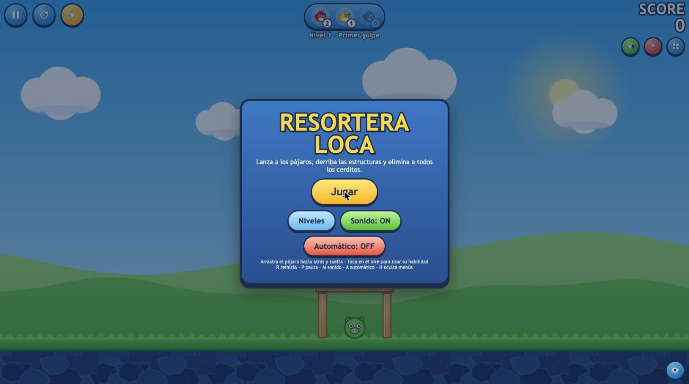
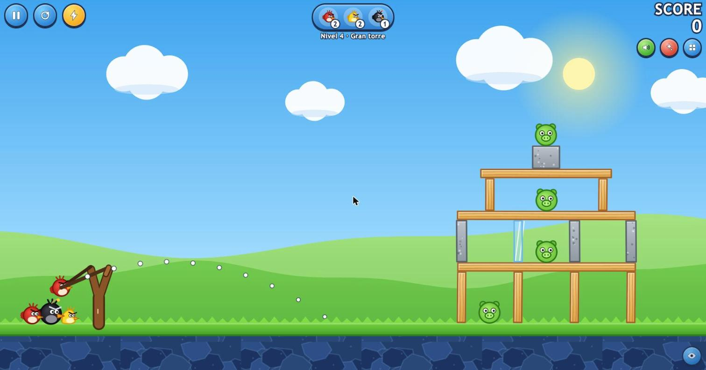
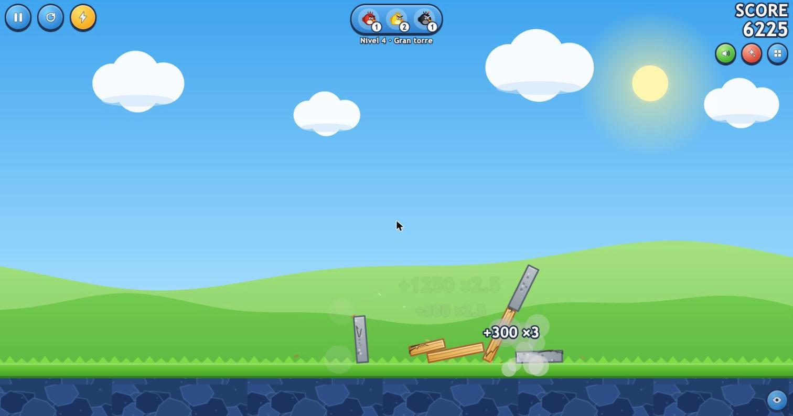

# WebBirds

Juego web 2D de física tipo *slingshot*: lanza pájaros con una resortera, derriba estructuras de madera, piedra y vidrio, y elimina a todos los cerditos.

Es **un solo archivo HTML** (`index.html`) sin dependencias: todo se dibuja con Canvas y los sonidos se generan con WebAudio. El motor de física es propio (sin librerías).



## Jugar

Abre `index.html` en el navegador (o sírvelo con cualquier servidor estático):

```bash
python3 -m http.server 8000   # y entra a http://localhost:8000
```



## Controles

| Acción | Control |
|---|---|
| Apuntar y lanzar | Arrastra el pájaro hacia atrás y suelta (mouse o táctil) |
| Habilidad del pájaro | Toca / clic en el aire (o `Espacio`, o el botón ⚡) |
| Reiniciar nivel | `R` |
| Siguiente nivel (al ganar) | `N` |
| Pausa | `P` / `Esc` |
| Sonido on/off | `M` |
| Modo automático | `A` |
| Ocultar / mostrar menús | `H` |

## Características

- **3 pájaros:** rojo (golpe básico), amarillo (acelera en el aire) y negro (explota con onda expansiva).
- **3 materiales** con resistencia distinta: madera, vidrio (frágil) y piedra (muy resistente), cada uno con sus partículas de destrucción.
- **5 niveles** definidos como datos en el array `LEVELS`.
- **Puntaje** por bloque y cerdito, multiplicador por combos, bonus por pájaros sobrantes y estrellas.
- **Modo automático:** simula trayectorias, elige ángulo y potencia, dispara y avanza de nivel solo.
- **Responsivo**, con menús que se pueden ocultar y sonido que se puede silenciar.



## Motor de física

Cuerpos rígidos (círculos y cajas rotadas), integración con paso fijo y sub-pasos, colisiones por SAT, solver iterativo de impulsos con warm starting, fricción, *sleeping* y daño por impacto según el material.

## Crear un nivel

Cada nivel es un objeto en `LEVELS`:

```js
{ name: 'Primer golpe', birds: ['red', 'red', 'yellow'],
  blocks: [ bk('wood', 1000, GY, 20, 100), bk('wood', 1070, 520, 170, 20) ],
  pigs:   [ pg(1070, GY) ] }
```

`bk(material, x, yBorde, w, h, ángulo)` coloca un bloque apoyado; `bc(...)` usa el centro; `pg(x, yBorde)` coloca un cerdito.
